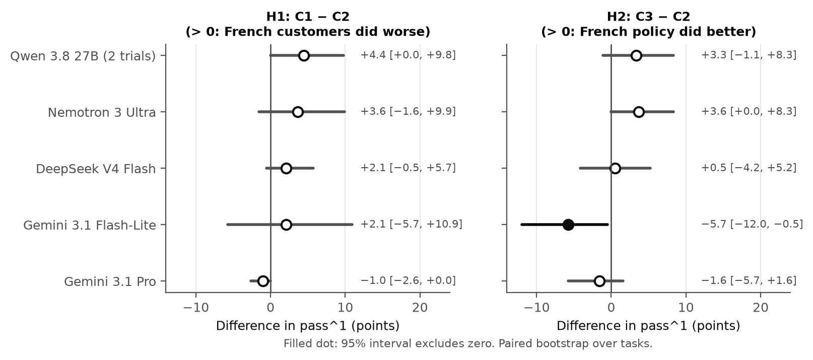

# τ-Loan: does a support agent follow policy as well when the customer speaks Quebec French?

Companies in bilingual markets like Quebec deploy LLM agents whose policy is
written in one language while customers write in another. This study measures
whether that costs policy compliance. It adds a `loan_servicing` domain to
[τ²-bench](https://github.com/sierra-research/tau2-bench): an agent for a
fictional lender, Boréal Finance, handles payments, payoffs, due-date changes,
late-fee waivers, hardship plans, autopay, third-party authorization and
transfers under a written policy, with 48 tasks that each have an English and a
Quebec French twin scored on identical criteria.

All names and data are fictional.

## The three conditions

| Condition | Policy | Customer | tau2 domain and split |
|---|---|---|---|
| C1 EN/EN | English | English | `loan_servicing`, `en_user` |
| C2 EN/FR | English | Quebec French | `loan_servicing`, `fr_user` |
| C3 FR/FR | Quebec French | Quebec French | `loan_servicing_fr`, `fr_user` |

Only the language of the policy and the customer changes. The tasks, database,
tools and scoring are the same. Five agent models ran every condition with 4
trials per task, against the same user simulator (`gpt-5.4-mini`):
2,589 conversations in all. The hypotheses, tests and exclusion rules were
registered before the runs in [`docs/EXPERIMENT_PLAN.md`](docs/EXPERIMENT_PLAN.md).

## Results



pass^1 (mean task success over trials) with 95% paired-bootstrap intervals over
the 48 tasks:

| Model | C1 EN/EN | C2 EN/FR | C3 FR/FR |
|---|---|---|---|
| Qwen 3.8 27B (free, 2 trials, 45 tasks) | 98.9% [96.6, 100.0] | 94.4% [89.5, 98.9] | 97.8% [94.4, 100.0] |
| Nemotron 3 Ultra (free) | 98.4% [96.4, 100.0] | 94.8% [88.5, 99.5] | 98.4% [95.8, 100.0] |
| DeepSeek V4 Flash | 97.9% [94.3, 100.0] | 95.8% [90.1, 100.0] | 96.4% [91.7, 100.0] |
| Gemini 3.1 Flash-Lite | 92.2% [86.5, 96.9] | 90.1% [81.8, 96.9] | 84.4% [74.0, 93.2] |
| Gemini 3.1 Pro | 92.7% [84.9, 99.0] | 93.8% [85.4, 100.0] | 92.2% [84.9, 97.9] |
| *Do-nothing baseline* | *≤ 27.1%* | *≤ 27.1%* | *≤ 27.1%* |

What the registered tests found:

- **H1 (French customers do worse, C2 < C1):** four of five models score lower
  in C2, by 2.1 to 4.4 points, but no interval excludes zero. With 48 tasks, a gap
  under about 10 points cannot be told apart from zero.
- **H2 (a French policy helps French customers, C3 > C2):** only Gemini 3.1
  Flash-Lite's interval excludes zero, and in the opposite direction
  (−5.7 [−12.0, −0.5]).
- **H3 (the French gap is larger for smaller and open models):** only Qwen's
  interval excludes zero (+5.5 [+0.5, +11.0]), and that rests on 2 trials.
- **H4 (French-specific failure types):** does not hold.
- No test survives the Holm correction. Most models are near the ceiling.
- **Exploratory:** with English callers whose record says
  `preferred_language: fr`, agents answered in French in 19% of those
  conversations (65 of 341; Flash-Lite 66%) and never for `en` borrowers. The
  borrower's French surname alone did not trigger it.

Full tables are in [`results/RESULTS.md`](results/RESULTS.md) (every number is
also in [`results/summary.csv`](results/summary.csv)), the failure analysis is
in [`docs/FAILURES.md`](docs/FAILURES.md), and all figures are in
[`results/figures/`](results/figures/).

## Links

- **Domain code:** [robertsolomon002/tau2-bench](https://github.com/robertsolomon002/tau2-bench),
  pinned in `pyproject.toml`. Upstream proposal:
  [sierra-research/tau2-bench#579](https://github.com/sierra-research/tau2-bench/issues/579);
  upstream pull request:
  [sierra-research/tau2-bench#638](https://github.com/sierra-research/tau2-bench/pull/638).
- **Trajectories (all 2,589 conversations):** [robsol/tau2-loan-servicing-trajectories](https://huggingface.co/datasets/robsol/tau2-loan-servicing-trajectories)
  on Hugging Face (CC BY 4.0).
- **Technical report:** `report/` (in progress).
- **What produced the results:** [`results/MANIFEST.json`](results/MANIFEST.json)
  pins both repos' commits, every model id, the seeds and the run dates.

## Setup

The study scripts read the domain's data from the fork checked out next to
this repo, so clone both side by side:

```sh
git clone https://github.com/robertsolomon002/tau2-loan-servicing-study
git clone https://github.com/robertsolomon002/tau2-bench
cd tau2-loan-servicing-study
uv sync
cp .env.example .env   # then fill in the keys you use
```

On Windows, set `PYTHONUTF8=1` and `PYTHONIOENCODING=utf-8` first.

Checks that make no API calls (the same as CI):

```sh
uv run ruff check .
uv run python scripts/lint_tasks.py
uv run pytest
```

## Reproduce one cell

A cell is one model in one condition: 48 tasks × 4 trials = 192 conversations.
The main runs used fork commit `66e179c`. The fork has since reworded the
French user text of task 41 (see `results/RESULTS.md` Section 4), so check out
that commit to rerun exactly what was measured:

```sh
git -C ../tau2-bench checkout 66e179c
```

Then preview the cost (no API calls) and run, for example DeepSeek V4 Flash in C2:

```sh
uv run python scripts/run_matrix.py plan configs/main/deepseek.toml --cell deepseek_C2 --out results/raw/repro
uv run python scripts/run_matrix.py run  configs/main/deepseek.toml --cell deepseek_C2 --out results/raw/repro
```

The runner is resumable, paces requests and stops at the budget caps in
`configs/runner.toml`; see [`docs/RUNNER.md`](docs/RUNNER.md). Every cell needs
an OpenAI key for the user simulator. LLM outputs vary from run to run even at
temperature 0, so expect results within the intervals above, not identical
ones.

Cost of one cell in our runs (LiteLLM's estimate, agent plus user simulator):

| Model | Config | Keys | Cost per cell |
|---|---|---|---|
| Nemotron 3 Ultra (free) | `configs/main/nemotron.toml` | OpenRouter, OpenAI | about $0.65 |
| DeepSeek V4 Flash | `configs/main/deepseek.toml` | OpenRouter, OpenAI | about $0.85 |
| Gemini 3.1 Flash-Lite | `configs/main/flash_lite.toml` | Vertex AI, OpenAI | about $1.05 to $1.27 |
| Gemini 3.1 Pro | `configs/main/gemini_pro.toml` | Vertex AI, OpenAI | about $12 to $16 |
| Qwen 3.8 27B | `configs/main/qwen.toml` | OpenRouter, OpenAI | about $5 (see below) |

Free OpenRouter models share a limit of about 1,000 requests a day, so a free
cell takes one to two days. OpenRouter withdrew the free Qwen model during the
runs; to rerun it, set `agent_llm = "openrouter/qwen/qwen3.8-27b"` (the paid
slug, about $0.024 per conversation for the agent) and the matching
`agent_cost_per_conv` in `configs/main/qwen.toml`. Vertex AI needs
`VERTEXAI_PROJECT` and `VERTEXAI_LOCATION=global` in `.env` and a Google Cloud
login.

To recompute every table and figure from the trajectories, download the
Hugging Face dataset and copy its `trajectories/` folder to `results/raw/main/`
(one folder per cell), then run
`uv run python -m analysis.report` and `uv run python -m analysis.figures`.

## Repo layout

```
configs/    runner settings and one config per model
scripts/    task and DB generation, task linter, runner, labelling, manifest
analysis/   metrics, failure analysis, report tables, figures
results/    RESULTS.md, summary.csv, figures, MANIFEST.json
docs/       experiment plan, domain spec, pilots, reviews, failures, log
ROADMAP.md  the project plan and progress tracker
```

## License and citation

MIT, matching τ²-bench. To cite this study, see [`CITATION.cff`](CITATION.cff).
